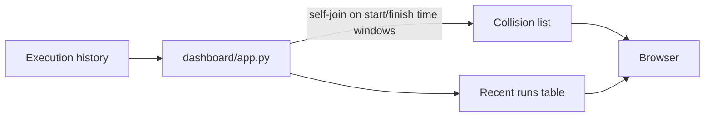

🟡 Portfolio demo, runnable locally, not deployed

# ops-dashboard-demo

Reads execution history for the other repos in this set and flags when two of them are scheduled to run at the same time, before that turns into a shared rate-limit incident. See [Related repos](#related-repos) for the rest of the platform.

This is a sanitized, generic rebuild for portfolio purposes. No real vendor, client, or company data is used anywhere in this repo. More context: [paulocremas-showcase](https://github.com/paulocremas-showcase). Full portfolio: [paulocremas.github.io](https://paulocremas.github.io).

## Table of contents
- [What this is](#what-this-is)
- [Flow](#flow)
- [Running it](#running-it)
- [Design notes](#design-notes)
- [Rules](#rules)
- [Related repos](#related-repos)

## What this is

The reason this exists at all: [data-extraction-demo](https://github.com/paulocremas-showcase/data-extraction-demo), [data-etl-demo](https://github.com/paulocremas-showcase/data-etl-demo), and [inventory-sync-demo](https://github.com/paulocremas-showcase/inventory-sync-demo) can all hit the same vendor's shared rate limit if their schedules overlap, even though each one individually respects its own concurrency limit. This dashboard doesn't fix that by itself, it makes the collision visible before it becomes an incident instead of after.

## Flow



1. [dashboard/app.py](dashboard/app.py)'s `find_collisions()` self-joins executions on their time windows: two different jobs collide if their `[started_at, finished_at]` ranges overlap, regardless of what either one's schedule looks like in isolation.
2. Reads from SQLite for the demo; in production this reads the same shape of data from BigQuery via the Cloud Run Admin API instead.

## Running it

```
python3 -m venv .venv && source .venv/bin/activate
pip install -r requirements.txt

uvicorn dashboard.app:app --reload
# open http://localhost:8000
```

Smoke tests: `python tests/test_dashboard.py`

## Design notes

- **A self-join on time windows, not a cron table diff.** Two jobs can collide even if neither one's own schedule ever looks wrong on its own, cron strings alone don't show you this, actual run windows do.
- **This is the fix for a real incident**, not a hypothetical: three pipelines sharing one vendor's per-account rate limit, on independently-set schedules, collided on the same day more than once, including one day where the collision meant zero new records were captured at all. The code fix was retrying on 429; this dashboard is the fix for not finding out about it three days later.
- **Read-only, on purpose.** This service never writes to the data it reads. A dashboard that can mutate the systems it's monitoring is a different, riskier piece of software.

## Rules

- This service must never gain write access to the systems it monitors.
- Collision detection stays a time-window self-join, not a schedule-string comparison, the two are not equivalent.
- No real vendor, client, or company names or data anywhere in this repo.

## Related repos

- [data-extraction-demo](https://github.com/paulocremas-showcase/data-extraction-demo)
- [data-etl-demo](https://github.com/paulocremas-showcase/data-etl-demo)
- [inventory-sync-demo](https://github.com/paulocremas-showcase/inventory-sync-demo)
- [ai-enrichment-demo](https://github.com/paulocremas-showcase/ai-enrichment-demo)
